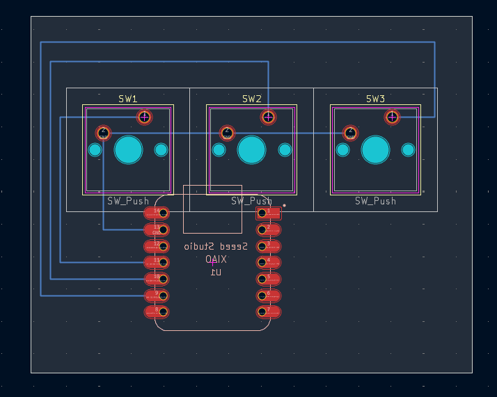
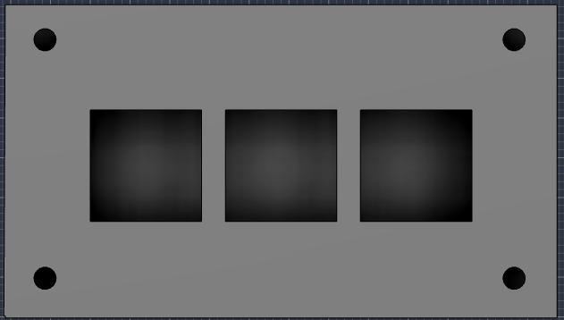
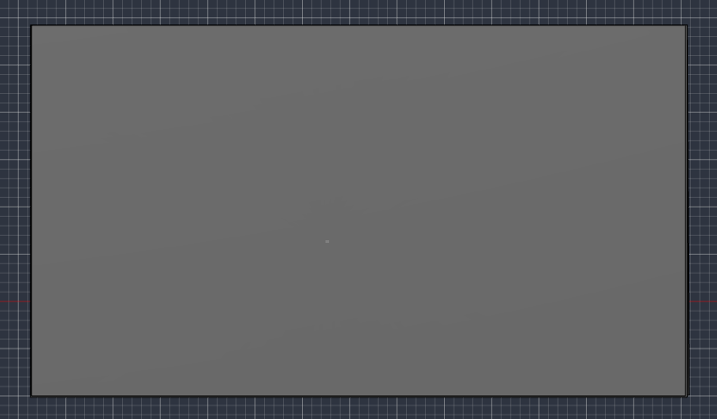

# StarDance Macropad

StarDance is a 3-key macropad built around a Seeed XIAO microcontroller. It runs KMK firmware and the keys are set to Copy, Paste and Undo.

I wanted a small pad for the shortcuts I use all the time while doing schoolwork and designing. Copy, paste and undo are the ones I hit most, so three keys felt like enough. This was also my first time designing a PCB and a case together, so I kept it simple to learn the whole process!!!

The case is two 3D printed parts: a base that holds the PCB, and a top plate with cutouts for the three switches. They’re held together with M3 screws through the four corner holes. There’s a cutout on one end so the USB-C port is reachable.

## Features

- 3 Kailh MX-style linear switches with DSA keycaps
- Seeed XIAO ESP32C3 microcontroller
- Custom PCB designed in KiCad
- Two-part 3D printed case with a USB cutout
- KMK firmware, with an easily editable keymap

Made in Fusion 360.

## Schematic

## PCB

## Firmware

Runs [KMK](https://github.com/KMKfw/kmk_firmware). Each switch connects
directly to one pin, with the other side to GND, so no diodes are needed.

| Switch | Pin | Default key |
| ------ | --- | ----------- |
| SW1 | D10 | Copy |
| SW2 | D9 | Paste |
| SW3 | D8 | Undo |

## More photos

## Bill of Materials

| Part | Qty | Unit | Total | Vendor |
| ---- | --- | ---- | ----- | ------ |
| Seeed XIAO ESP32C3 (microcontroller) | 1 | $4.99 | $4.99 | [Seeed Studio](URL) |
| Kailh Linear White switches, 10 pack | 1 | $6.95 | $6.95 | [Adafruit](URL) |
| DSA keycaps for MX switches, Dark Gray | 1 | $5.95 | $5.95 | [Adafruit](URL) |
| Custom PCB (5 boards, standard spec) | 1 | $2.00 | $2.00 | [JLCPCB](URL) |
| DFDU 960pc M3 screw assortment kit | 1 | $9.99 | $9.99 | [Amazon](URL) |
| Tax & shipping | - | - | $0.00 | - |

**Total: $29.88**
